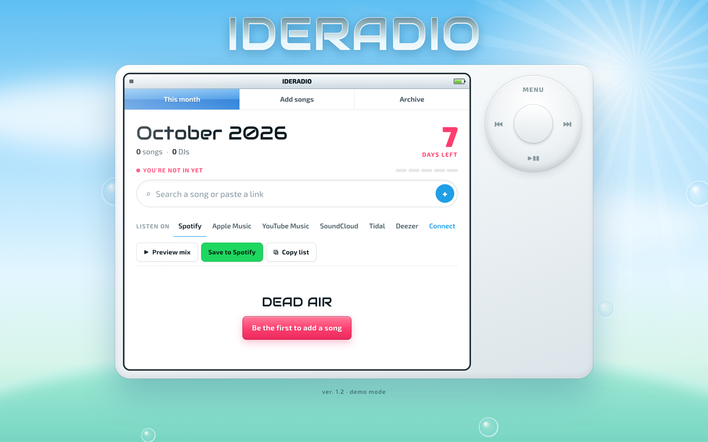
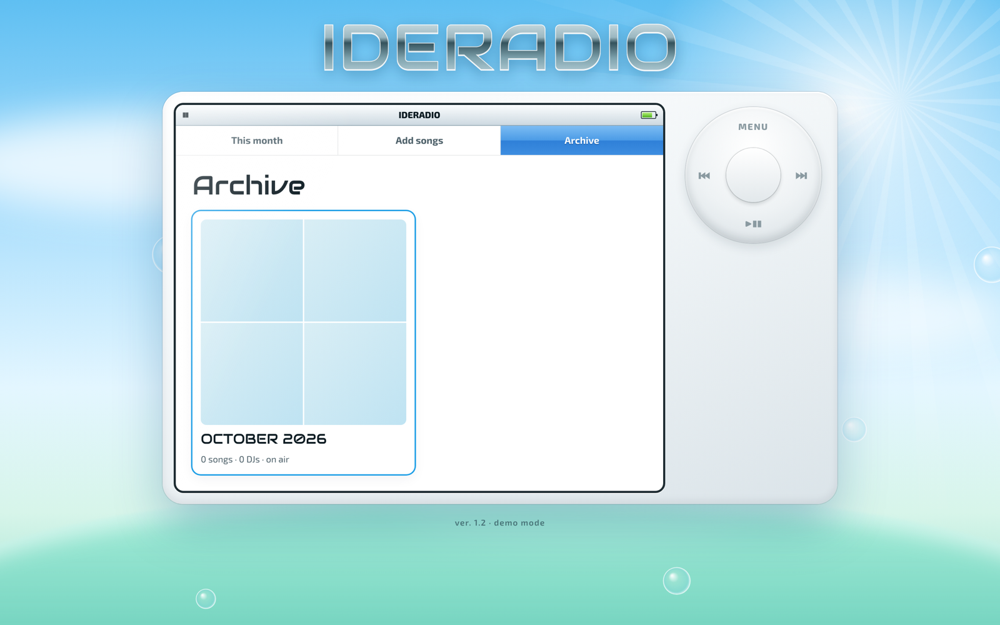

<div align="center">

# IDERADIO

**A shared monthly playlist for my class, styled like a music player from 2006.**


[**Live site**](https://ideradio.netlify.app/) · [Portfolio](https://www.yousef.studio/)

</div>



Every month the class gets a fresh playlist. Everyone adds up to five songs, from any streaming service, and when the month
ends it goes into the archive. There are no accounts and no database to run.

## Features

- **Paste any link:** Spotify, Apple Music, YouTube Music, SoundCloud, Tidal and Deezer links are recognised. You can also search by name.
- **Listen anywhere:** every track links out to your service of choice. *Preview mix* plays 30-second previews in the page.
- **Save to Spotify:** connect your account (PKCE OAuth, no server secret) and save the whole month as a playlist.
- **Monthly archive:** past months become album-art grids you can flick back through.
- **Trending suggestions** from the Apple Music most-played chart, cached at the edge.
- **Anonymous but fair:** each browser gets a private token, hashed on the server, so people can edit or remove only their own picks.
- **Safe concurrent writes:** the API uses ETags and retries, so two people adding songs at the same time can't overwrite each other.
- **Click-wheel interface** with an ambient soundtrack retuned to A=432 Hz.



## How it's built

```
site/                      static front end (HTML, CSS, vanilla JS)
netlify/functions/songs.mjs   playlist API: one JSON blob per month in Netlify Blobs
netlify/functions/charts.mjs  Apple Music chart feed with previews
```

---

Class playlist site on Netlify. Static files are in `site/`. The shared playlist API is `netlify/functions/songs.mjs`, which stores data in Netlify Blobs, so no separate database is needed.

## Update the live site
From this folder: `npx netlify-cli deploy --prod` (needs Node 22.12+).

## Spotify button (optional)
1. Create an app at https://developer.spotify.com/dashboard. Choose **Web API**.
2. Add your site's address as a **Redirect URI** with a trailing slash, e.g. `https://ideradio.netlify.app/`.
3. Paste the **Client ID** into `site/config.js`, then deploy again.
4. New Spotify apps run in development mode, so only accounts listed under **User Management** can connect.

## Moderation
Netlify → your site → **Blobs** → store `ideradio`. There is one entry per month, in the form `YYYY-MM`.

## Audio
`site/audio/ambient.mp3` is retuned to A=432 Hz and slowed to about 79% speed.
