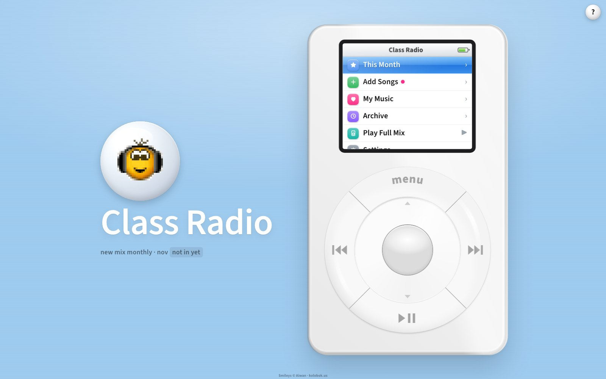
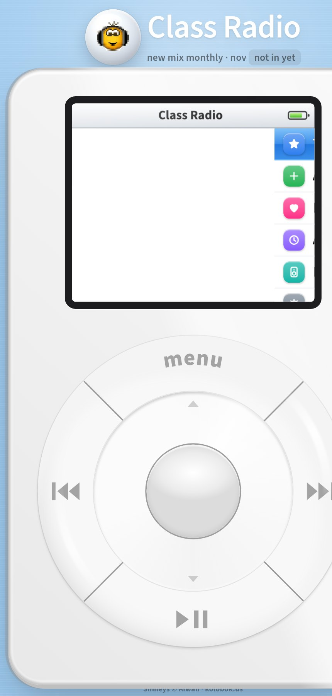

# Class Radio

A shared monthly playlist for a class, club or any group, dressed up as a first-generation iPod.

Everyone adds 1 to 5 songs a month. The songs build into one mix that plays on a shared speaker, and every past month stays in the Archive. Nobody needs an account: people pick a name (or stay anonymous) and add songs from search, a pasted link, or their own Spotify, YouTube Music or Apple Music playlists. The mix opens in whichever app each person uses.





## What it does
- **The iPod is the interface.** Slide around the click wheel to scroll, tap the top or bottom of the ring to step, press the centre to select, and use menu to go back. On phones, taps on the wheel use the iPhone's haptics.
- **Monthly mix.** Each person adds up to 5 songs a month, stacks them in a crate first, then submits. Duplicates are blocked, and a new mix starts every month.
- **Play Full Mix.** Plays full songs through YouTube on whatever device is plugged into the speaker. Preview Mix plays 30-second clips.
- **Search that finds the real versions.** Explicit versions first, with 30-second previews, plus suggestions: For you, Trending, Class faves and a monthly mood.
- **Your own music.** Connect Spotify to see your liked songs, top songs and playlists. Apple Music users can paste a shared playlist link instead.
- **Save the mix** to Spotify or YouTube Music as a playlist.
- **Make it yours.** Choose an iPod classic, mini or nano in white, black, chrome, U2 red or the mini colours. The page follows the device's light or dark mode.

## Set it up (about 15 minutes, free)
It runs on Cloudflare Pages with a small Cloudflare D1 database. You need Node 22+ and a free Cloudflare account.

1. Install Wrangler and sign in:
   ```bash
   npm i -g wrangler
   wrangler login
   ```
2. Create the database and copy the `database_id` it prints into `wrangler.toml`:
   ```bash
   wrangler d1 create class-radio
   ```
3. Create the table:
   ```bash
   wrangler d1 execute class-radio --remote --file=schema.sql
   ```
4. Edit `site/config.js`: set your station's `name`, a `tagline`, and the `owner` people should ask for access.
5. Deploy:
   ```bash
   wrangler pages deploy --project-name=class-radio --branch=main
   ```
Your site is now at `https://class-radio.pages.dev` (or whatever project name you chose).

### Optional extras
- **Full songs (Play Full Mix) and YouTube playlist links:** create a YouTube Data API v3 key in Google Cloud, then `wrangler pages secret put YT_KEY --project-name=class-radio`.
- **Spotify connect and saving:** create an app at developer.spotify.com, add your site URL (with a trailing `/`) as a redirect URI, and put its Client ID in `config.js`. In development mode, add each person's Spotify email under User Management.
- **YouTube Music connect and saving:** in Google Cloud, set up the Google Auth Platform (External), create a Web OAuth client with your site as an authorized JavaScript origin, add people as test users, and put the Client ID in `config.js`.
- **Apple Music library connect:** needs a paid Apple Developer membership. Set `APPLE_TEAM_ID`, `APPLE_KEY_ID` and `APPLE_PRIVATE_KEY` (a MusicKit key) as Pages secrets. Without it, Apple Music users can still paste playlist links.

## Moderation
Cloudflare dashboard → Storage & Databases → D1 → your database → table `songs`. Delete a row to remove a song.

## Credits
- Smileys by Aiwan, [kolobok.us](https://www.kolobok.us). Free for non-commercial sites as long as every page shows the credit (it's in the footer). Keep it non-commercial or swap them out.
- Song search and previews: Deezer and the iTunes Search API. Full songs: YouTube.
- iPod and the iPod designs are Apple's trademarks; this is a fan-made tribute, not affiliated with Apple.
